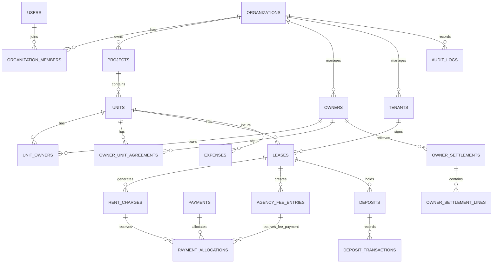
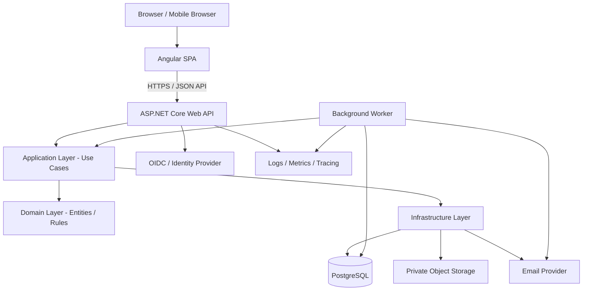
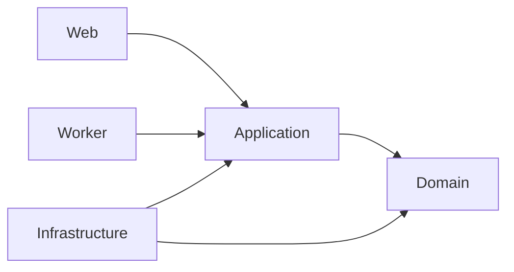

# Roomfolio — Project Plan

> **เอกสารวางแผนผลิตภัณฑ์และเทคนิค (Working Draft)**  
> เวอร์ชัน: 0.1 · วันที่: 21 ตุลาคม 2026  
> สถานะ: สำหรับใช้วางแผน MVP และตรวจสอบกับนายหน้าผู้ใช้งานจริง

## 1. Product Overview

**Roomfolio** คือ SaaS สำหรับนายหน้าอิสระที่ดูแลห้องชุดให้เช่าจำนวนมากจากหลายโครงการและหลายเจ้าของ โดยรวมข้อมูลทรัพย์สิน สัญญาเช่า รายการค่าเช่า การรับเงินจริง ค่าใช้จ่าย ค่าบริหาร ค่านายหน้า ยอดเงินที่ต้องส่งเจ้าของ และรายงานไว้ในระบบเดียว

Roomfolio **ไม่ใช่ระบบบริหารนิติบุคคลหรือระบบแจ้งซ่อม** เนื่องจากโครงการมีเครื่องมือของตนเองอยู่แล้ว จึงไม่สร้างฟีเจอร์แจ้งซ่อมในขอบเขตผลิตภัณฑ์นี้

### 1.1 กลุ่มลูกค้าเป้าหมาย

- นายหน้าอิสระที่ดูแลห้องประมาณ 100–500 ห้อง
- มีหลายโครงการและเจ้าของห้องหลายราย
- มีรายได้จากทั้งค่านายหน้าปล่อยเช่าครั้งเดียวและค่าบริหารรายเดือน
- มีทั้งกรณีผู้เช่าจ่ายค่าเช่าให้เจ้าของโดยตรง และกรณีผู้เช่าจ่ายผ่านนายหน้า
- ปัจจุบันมีโอกาสใช้ Excel, Google Sheets, LINE, ปฏิทิน และเอกสารหลายแหล่งร่วมกัน

### 1.2 Value Proposition

1. เห็นสถานะห้อง สัญญา และกำหนดชำระทั้งหมดจากจุดเดียว
2. แยก **ยอดที่ต้องเรียกเก็บ**, **เงินที่รับจริง**, **เงินที่นายหน้าถืออยู่**, และ **ยอดที่ต้องส่งเจ้าของ** ออกจากกันอย่างชัดเจน
3. รองรับทั้งการรับค่าเช่าโดยเจ้าของตรงและการรับผ่านนายหน้า
4. คำนวณและติดตามค่านายหน้าครั้งเดียวกับค่าบริหารรายเดือน
5. สร้าง Owner Statement และรายงานประจำเดือนได้ โดยลดการทำ Excel ด้วยมือ

### 1.3 เป้าหมาย MVP

ภายในรุ่นแรก ลูกค้าหนึ่งรายต้องสามารถนำห้อง 100+ ห้องเข้าระบบ จัดการสัญญาและกำหนดค่าเช่า บันทึกการจ่ายจริง ติดตามค่าธรรมเนียมของนายหน้า และสรุปยอดเจ้าของได้ โดยข้อมูลไม่ปะปนกับลูกค้ารายอื่น

### 1.4 สิ่งที่ไม่รวมใน MVP

- ระบบแจ้งซ่อมหรือจัดการช่าง
- ระบบนิติบุคคล/ค่าส่วนกลางของโครงการ
- ระบบบัญชีเต็มรูปแบบหรือ General Ledger
- การเชื่อมต่อธนาคารและรับชำระเงินอัตโนมัติ
- แอป iOS/Android แยกจากเว็บ
- การอ่านข้อความจากสลิปหรือการจับคู่รายการด้วย AI
- Marketplace สำหรับประกาศหาห้องและจับคู่ผู้เช่า

---

## 2. Business Rules ที่ต้องตกลงให้ชัด

กติกาทางธุรกิจเหล่านี้มีผลต่อฐานข้อมูลและการคำนวณเงินโดยตรง ต้องยืนยันกับลูกค้าทดลองก่อนใช้งานจริง

1. **วิธีรับค่าเช่าถูกกำหนดระดับสัญญาเช่า**: `direct_to_owner` หรือ `through_agent` และอาจเปลี่ยนได้เมื่อทำสัญญาใหม่หรือมีข้อตกลงแก้ไข โดยต้องเก็บประวัติการเปลี่ยนแปลง
2. **การรับเงินจริงไม่เท่ากับยอดที่ต้องเก็บ**: รายการค่าเช่าที่สร้างขึ้นไม่ใช่รายรับเงินจริงจนกว่าจะมีการยืนยันการชำระ
3. **เงินที่ผู้เช่าจ่ายให้เจ้าของโดยตรงไม่ใช่เงินสดของนายหน้า**: นายหน้าบันทึกหรือยืนยันสถานะตามหลักฐาน/คำยืนยันของเจ้าของได้ แต่รายการนั้นห้ามเพิ่มยอดเงินที่นายหน้าถืออยู่
4. **เงินที่ผู้เช่าจ่ายผ่านนายหน้า**: บันทึกเป็นเงินที่ได้รับโดยนายหน้า และติดตามต่อว่าจัดสรรให้รายการใดและส่งให้เจ้าของแล้วหรือยัง
5. **ค่าบริหารรายเดือน**: คำนวณตามข้อตกลง เช่น อัตราร้อยละของค่าเช่าหรือจำนวนเงินคงที่ โดยอาจเรียกเก็บแยกจากเจ้าของหรือหักจากเงินที่ต้องส่งเจ้าของเมื่อข้อตกลงอนุญาต
6. **ค่านายหน้าครั้งเดียว**: มีผู้รับผิดชอบจ่ายชัดเจน เช่น เจ้าของหรือผู้เช่า มีวันครบกำหนด วิธีคำนวณ และสถานะการรับเงิน
7. **ห้ามหักค่าธรรมเนียมซ้ำ**: รายการ fee ที่หักใน Owner Settlement แล้วต้องไม่ถูกนำไปสร้างใบเรียกเก็บซ้ำสำหรับยอดเดียวกัน
8. **เงินประกันแยกจากรายได้ค่าเช่า**: ต้องบันทึกผู้ถือเงินประกัน ยอดรับ คืน และหักเงินประกันแยกจากรายได้/ค่าบริการ
9. **รองรับการจ่ายบางส่วนและจ่ายหลายครั้ง**: ค่าเช่าหนึ่งงวดอาจถูกชำระด้วยหลายรายการ และการจ่ายหนึ่งครั้งอาจถูกจัดสรรให้หลายงวดได้
10. **ไม่ลบธุรกรรมที่ยืนยันแล้วแบบ hard delete**: การยกเลิกหรือแก้ไขต้องสร้างสถานะ void/reversal และมี audit log
11. **เจ้าของร่วมหนึ่งห้อง**: รองรับเจ้าของหลายคนต่อห้อง โดยมีสัดส่วนการถือครอง หากต้องแบ่งยอดเงินจริงตามสัดส่วนให้ใช้กติกาที่ตกลงและบันทึกลงรายการ settlement ให้ตรวจสอบย้อนหลังได้
12. **วันครบกำหนดและรอบรายงาน**: จัดเก็บวันเวลาอย่างเหมาะสมและแสดงผลด้วย timezone `Asia/Bangkok` ส่วน period การเงินใช้วันที่เริ่ม/สิ้นสุดหรือเดือนที่ชัดเจน

> ข้อควรระวัง: Roomfolio เป็นเครื่องมือบริหารข้อมูลและติดตามเงิน ไม่ควรเรียกตนเองว่าเป็นบัญชีธนาคารหรือผู้ให้บริการชำระเงิน การรับเงินจริงและการหักเงินจากยอดเจ้าของต้องเป็นไปตามข้อตกลงจริงของคู่สัญญา

---

## 3. Core Workflows

### 3.1 Workflow A — ผู้เช่าจ่ายเจ้าของโดยตรง

1. สร้างสัญญาเช่าและตั้ง `payment_mode = direct_to_owner`
2. ระบบสร้าง `rent_charges` ตามรอบค่าเช่า
3. ก่อนถึงกำหนด ระบบเตือนนายหน้าให้ติดตามสถานะ
4. เมื่อผู้เช่าจ่ายเจ้าของ เจ้าของหรือนายหน้าบันทึกหลักฐาน/วันที่/จำนวนเงิน และระบุผู้รับเงินจริงเป็น `owner`
5. ระบบจัดสรรยอดชำระเข้ากับค่าเช่างวดที่เกี่ยวข้อง
6. ระบบปิดยอดค่าเช่าตามจำนวนที่ชำระจริง และคงส่วนที่ยังขาดเป็นยอดค้าง
7. หากมีค่าบริหารรายเดือนหรือค่านายหน้าที่เจ้าของต้องจ่าย ระบบสร้าง `agency_fee_entries` แยกต่างหาก
8. ระบบติดตามใบเรียกเก็บค่าบริการนั้นจนกว่าจะได้รับเงินจริง

**ผลทางการเงิน:** รายการจ่ายตรงมีผลต่อสถานะค่าเช่า แต่ไม่เพิ่มเงินสดที่นายหน้าถืออยู่ และไม่ทำให้เกิดยอดเงินที่ต้องส่งเจ้าของผ่านนายหน้า

### 3.2 Workflow B — ผู้เช่าจ่ายผ่านนายหน้า

1. สร้างสัญญาเช่าและตั้ง `payment_mode = through_agent`
2. ระบบสร้าง `rent_charges` ตามกำหนด
3. เมื่อได้รับเงิน ให้สร้าง `payments` โดย `received_by_party = agency` พร้อมวันที่ วิธีรับเงิน และหลักฐาน
4. จัดสรรการรับเงินผ่าน `payment_allocations` ไปยังงวดค่าเช่าหนึ่งงวดหรือหลายงวด
5. ยอดที่จัดสรรแล้วลดค่าเช่าค้างชำระ แต่เงินที่รับมายังต้องติดตามในฐานะเงินที่ถือแทนเจ้าของ
6. บันทึกค่าใช้จ่ายที่นายหน้าออกแทนเจ้าของได้ พร้อมหลักฐานและการอนุมัติถ้าจำเป็น
7. คำนวณค่าบริหาร/ค่านายหน้าที่สามารถหักจากยอดเจ้าของได้ตามข้อตกลง
8. สร้าง `owner_settlements` ตามรอบ และสร้างรายละเอียดใน `owner_settlement_lines`
9. ตรวจสอบยอดรวม แล้วเปลี่ยนสถานะเป็น `approved` หรือขั้นตรวจทานที่กำหนด
10. เมื่อส่งเงินเจ้าของจริง ให้บันทึกการโอน วันเวลา วิธีการ และหลักฐาน จากนั้นเปลี่ยนสถานะ settlement เป็น `paid`

**ผลทางการเงิน:** เงินที่รับผ่านนายหน้าจะเป็นเงินที่นายหน้าต้องติดตามการส่งต่อ ห้ามแสดงเป็นรายได้ของนายหน้าทั้งจำนวน

### 3.3 Workflow C — ค่าบริหารรายเดือน

1. ตั้งข้อตกลงในระดับเจ้าของ/ห้อง หรือข้อตกลงอื่นที่ตกลงไว้
2. เลือกวิธีคำนวณ เช่น `fixed_amount` หรือ `percentage`
3. สร้างรายการเรียกเก็บค่าบริหารรายเดือนตามรอบ
4. หากเลือก `invoice` ให้ติดตามรับเงินแยกจากค่าเช่า
5. หากเลือก `deduct_from_settlement` ให้หักจากยอดเงินที่ต้องส่งเจ้าของเฉพาะกรณีที่มีเงินรับผ่านนายหน้าและมีสิทธิ์หักตามข้อตกลง
6. เก็บอัตราและจำนวนเงินที่คำนวณจริงในรายการประจำงวด เพื่อไม่ให้การเปลี่ยนข้อตกลงในอนาคตเปลี่ยนยอดย้อนหลัง

### 3.4 Workflow D — ค่านายหน้าครั้งเดียว

1. บันทึกข้อตกลงค่านายหน้าในสัญญาเช่าหรือการปล่อยเช่า
2. ระบุผู้จ่าย (`owner` หรือ `tenant`), วิธีคำนวณ (`fixed_amount` หรือ `percentage`) และเงื่อนไขที่ทำให้เกิดสิทธิรับค่านายหน้า
3. เมื่อเข้าเงื่อนไข ให้สร้าง `agency_fee_entries` ประเภท `leasing_commission`
4. ติดตามสถานะจาก `pending` → `due` → `partially_paid/paid` หรือ `cancelled`
5. ถ้าหักจากยอดเจ้าของ ให้เชื่อมรายการ fee กับ settlement line เพื่อป้องกันการหักซ้ำ

### 3.5 Workflow E — เงินประกัน

1. เก็บจำนวนเงินประกันและผู้ถือเงินตามสัญญา
2. บันทึกธุรกรรมรับเงินประกันแยกต่างหาก
3. เมื่อคืนหรือหักเงินประกัน ให้บันทึกเป็นธุรกรรมใหม่ที่มีเหตุผลและหลักฐาน
4. เงินประกันไม่รวมในรายรับค่าเช่าหรือรายได้ค่านายหน้า เว้นแต่มีเหตุการณ์หักเงินที่ถูกต้องตามข้อตกลง

### 3.6 สถานะที่แนะนำ

- Rent charge: `draft`, `due`, `partially_paid`, `paid`, `overdue`, `cancelled`
- Payment: `recorded`, `confirmed`, `voided`, `reversed`
- Agency fee: `pending`, `due`, `partially_paid`, `paid`, `cancelled`, `written_off`
- Owner settlement: `draft`, `review`, `approved`, `paid`, `cancelled`
- Lease: `draft`, `active`, `ending_soon`, `ended`, `terminated`

สถานะ `overdue` และ `ending_soon` สามารถคำนวณจาก due date / วันปัจจุบันได้ ไม่จำเป็นต้องเก็บทุกสถานะไว้ในฐานข้อมูลหากจะทำให้ข้อมูลคลาดเคลื่อน ควรแยกสถานะการยืนยันธุรกรรมออกจากสถานะที่คำนวณได้

---

## 4. Information Architecture / หน้าจอหลัก

1. **Dashboard** — ห้องทั้งหมด ห้องว่าง สัญญาใกล้หมด ค่าเช่าครบกำหนด ยอดค้าง เงินที่นายหน้าถืออยู่ เงินรอส่งเจ้าของ และค่าบริการที่ค้างรับ
2. **Projects & Units** — โครงการ อาคาร ห้อง เจ้าของร่วม สถานะห้อง และประวัติผู้เช่า
3. **Owners** — ข้อมูลติดต่อ ข้อตกลงบริหาร สรุปยอด และ Owner Statement
4. **Tenants** — ข้อมูลผู้เช่า สัญญาปัจจุบัน ประวัติการชำระ และเงินประกัน
5. **Leases** — สัญญา เงื่อนไขค่าเช่า วิธีรับเงิน วันครบกำหนด และเงื่อนไขค่าธรรมเนียม
6. **Rent Collection** — ค่าเช่าที่ต้องรับ การรับเงินโดยตรงกับเจ้าของ การรับผ่านนายหน้า การจัดสรรยอด และยอดค้าง
7. **Agency Fees** — ค่าบริหารรายเดือน ค่านายหน้าครั้งเดียว ใบเรียกเก็บ และสถานะรับเงินจริง
8. **Owner Settlements** — สรุปเงินที่ต้องส่งเจ้าของ รายละเอียดหัก/เพิ่ม ตรวจทาน อนุมัติ และบันทึกการโอน
9. **Expenses** — ค่าใช้จ่ายของห้อง ผู้จ่าย ผู้รับผิดชอบ และสิทธิ์ในการหักจาก settlement
10. **Deposits** — เงินประกัน ผู้ถือเงิน รายการรับ/คืน/หัก และยอดคงเหลือ
11. **Reports & Documents** — Owner Statement, รายงานนายหน้า, รายงานกระแสเงิน, export CSV/XLSX และเอกสารสัญญา
12. **Settings** — ผู้ใช้ สิทธิ์ แพ็กเกจ บริษัท วิธีแจ้งเตือน และค่าตั้งต้น

ไม่มีเมนูหรือโมดูลแจ้งซ่อมใน Roomfolio MVP

---

## 5. Database Architecture (PostgreSQL)

### 5.1 หลักการออกแบบ

- ใช้ PostgreSQL และ UUID เป็น primary key
- ใช้ `organization_id` ในตารางธุรกิจทุกตารางที่มีข้อมูลของลูกค้า เพื่อควบคุม tenant boundary
- ใช้ Foreign Key และ unique constraints จริง ไม่พึ่งการตรวจสอบใน application อย่างเดียว
- ใช้ `numeric(14,2)` สำหรับจำนวนเงิน ห้ามใช้ floating point กับยอดเงิน
- ใช้ `date` สำหรับวันที่ตามสัญญา/รอบชำระ และ `timestamptz` สำหรับเหตุการณ์ที่มีเวลา
- ใช้ `created_at`, `created_by`, `updated_at`, `updated_by` ในตารางที่เหมาะสม และ `audit_logs` สำหรับเหตุการณ์สำคัญ
- ธุรกรรมที่ยืนยันแล้วควร void/reverse แทนการลบ
- ข้อมูลสัญญาและกติกาที่ใช้คำนวณเงินในอดีตต้องถูก snapshot ลงรายการธุรกรรม เพื่อไม่ให้แก้ไขย้อนหลังเมื่อแก้ข้อตกลง
- อย่าเก็บสถานะที่คำนวณได้หลายที่โดยไม่จำเป็น เช่นยอดค้าง ควรคำนวณจาก charge amount ลบ allocations ที่ยืนยันแล้ว หรือใช้ยอดสรุปที่มีวิธี reconcile ชัดเจน
- เอกสารเก็บใน object storage/private bucket ส่วนฐานข้อมูลเก็บ metadata และ storage key เท่านั้น

### 5.2 ER Diagram (แนวคิด)



### 5.3 ตารางและคอลัมน์หลัก

> รายการต่อไปนี้เป็นโครงสร้างเชิงตรรกะสำหรับเริ่มพัฒนา ไม่ใช่ DDL migration ฉบับสุดท้าย บางคอลัมน์สามารถเพิ่มตามผลสัมภาษณ์และการทดสอบได้

#### A. Tenant, User, Subscription

**`organizations`** — หนึ่งรายการต่อหนึ่งธุรกิจที่สมัคร SaaS

- `id UUID PK`
- `name VARCHAR(200) NOT NULL`
- `legal_name VARCHAR(250) NULL`
- `tax_id VARCHAR(30) NULL`
- `default_currency CHAR(3) NOT NULL DEFAULT 'THB'`
- `timezone VARCHAR(50) NOT NULL DEFAULT 'Asia/Bangkok'`
- `status VARCHAR(20) NOT NULL` — `active`, `suspended`, `closed`
- `created_at TIMESTAMPTZ NOT NULL`, `updated_at TIMESTAMPTZ NOT NULL`

**`users`** — ผู้ใช้เข้าสู่ระบบ

- `id UUID PK`
- `email VARCHAR(320) NOT NULL UNIQUE`
- `display_name VARCHAR(200) NOT NULL`
- `auth_provider VARCHAR(30) NOT NULL` — เช่น `local`, `oidc`
- `external_subject VARCHAR(250) NULL`
- `status VARCHAR(20) NOT NULL`
- `created_at`, `updated_at`

> ถ้าใช้ external identity provider ไม่ควรเก็บรหัสผ่านเอง เว้นแต่จำเป็นและมีมาตรการ password hashing ที่ถูกต้อง

**`organization_members`** — ความสัมพันธ์ผู้ใช้กับองค์กร

- `organization_id UUID FK -> organizations.id`
- `user_id UUID FK -> users.id`
- `role VARCHAR(30) NOT NULL` — `owner`, `admin`, `staff`, `viewer`
- `status VARCHAR(20) NOT NULL`
- `created_at TIMESTAMPTZ NOT NULL`
- PK (`organization_id`, `user_id`)

**`subscriptions`**

- `id UUID PK`, `organization_id UUID FK`
- `plan_code VARCHAR(40) NOT NULL`
- `status VARCHAR(20) NOT NULL` — `trial`, `active`, `past_due`, `cancelled`
- `room_limit INT NOT NULL`
- `user_limit INT NULL`
- `current_period_start DATE NULL`, `current_period_end DATE NULL`
- `started_at TIMESTAMPTZ NOT NULL`, `cancelled_at TIMESTAMPTZ NULL`

#### B. Project, Unit, Owner, Tenant

**`projects`**

- `id UUID PK`, `organization_id UUID FK`
- `name VARCHAR(200) NOT NULL`
- `address TEXT NULL`
- `district VARCHAR(100) NULL`, `province VARCHAR(100) NULL`, `postal_code VARCHAR(10) NULL`
- `note TEXT NULL`, `status VARCHAR(20) NOT NULL`
- `created_at`, `updated_at`, `created_by UUID FK -> users.id`
- Unique (แนวทาง): (`organization_id`, `name`) หากองค์กรไม่ต้องการชื่อโครงการซ้ำ

**`units`**

- `id UUID PK`, `organization_id UUID FK`, `project_id UUID FK -> projects.id`
- `building VARCHAR(100) NULL`, `floor VARCHAR(30) NULL`
- `unit_number VARCHAR(50) NOT NULL`
- `bedrooms NUMERIC(3,1) NULL`, `bathrooms NUMERIC(3,1) NULL`, `area_sqm NUMERIC(8,2) NULL`
- `status VARCHAR(30) NOT NULL` — เช่น `available`, `occupied`, `reserved`, `inactive`
- `note TEXT NULL`, `created_at`, `updated_at`
- Unique (`organization_id`, `project_id`, `unit_number`)

**`owners`**

- `id UUID PK`, `organization_id UUID FK`
- `display_name VARCHAR(200) NOT NULL`
- `owner_type VARCHAR(20) NOT NULL` — `individual`, `company`
- `phone VARCHAR(50) NULL`, `email VARCHAR(320) NULL`
- `tax_id VARCHAR(30) NULL`, `billing_address TEXT NULL`
- `preferred_contact_channel VARCHAR(30) NULL`
- `status VARCHAR(20) NOT NULL`, `note TEXT NULL`
- `created_at`, `updated_at`

**`unit_owners`** — รองรับเจ้าของร่วมและสัดส่วนการถือครอง

- `organization_id UUID FK`
- `unit_id UUID FK -> units.id`
- `owner_id UUID FK -> owners.id`
- `ownership_percentage NUMERIC(5,2) NOT NULL`
- `effective_from DATE NOT NULL`, `effective_to DATE NULL`
- PK (`unit_id`, `owner_id`, `effective_from`)
- Constraint: percentage ต้องมากกว่า 0 และไม่เกิน 100; ตรวจรวมสัดส่วนของเจ้าของที่ active ต่อห้องใน application/transaction logic

**`tenants`**

- `id UUID PK`, `organization_id UUID FK`
- `display_name VARCHAR(200) NOT NULL`
- `phone VARCHAR(50) NULL`, `email VARCHAR(320) NULL`
- `identity_reference_encrypted TEXT NULL` — ถ้าจำเป็นต้องเก็บ ให้เข้ารหัสและจำกัดสิทธิ์
- `status VARCHAR(20) NOT NULL`, `note TEXT NULL`
- `created_at`, `updated_at`

#### C. ข้อตกลงกับเจ้าของและสัญญาเช่า

**`owner_unit_agreements`** — ข้อตกลงการบริหารกับเจ้าของต่อห้อง (เปลี่ยนได้ตามช่วงเวลา)

- `id UUID PK`, `organization_id UUID FK`
- `owner_id UUID FK -> owners.id`, `unit_id UUID FK -> units.id`
- `effective_from DATE NOT NULL`, `effective_to DATE NULL`
- `management_fee_type VARCHAR(20) NOT NULL` — `none`, `fixed_amount`, `percentage`
- `management_fee_value NUMERIC(14,2) NOT NULL DEFAULT 0`
- `management_fee_basis VARCHAR(30) NULL` — เช่น `rent_charged`, `rent_collected`
- `fee_collection_method VARCHAR(30) NOT NULL` — `invoice`, `deduct_from_settlement`
- `settlement_frequency VARCHAR(20) NOT NULL DEFAULT 'monthly'`
- `allow_expense_deduction BOOLEAN NOT NULL DEFAULT FALSE`
- `agreement_document_id UUID NULL`
- `created_at`, `updated_at`

ค่าร้อยละควรบันทึกเป็นตัวเลข เช่น `5.00` หมายถึง 5% และมี validation ตามชนิดค่าธรรมเนียม

**`leases`**

- `id UUID PK`, `organization_id UUID FK`
- `unit_id UUID FK -> units.id`, `tenant_id UUID FK -> tenants.id`
- `lease_number VARCHAR(80) NULL`
- `start_date DATE NOT NULL`, `end_date DATE NOT NULL`
- `monthly_rent NUMERIC(14,2) NOT NULL`
- `rent_due_day SMALLINT NOT NULL` — 1–31; กำหนดกติกาสำหรับเดือนที่ไม่มีวันนั้น
- `payment_mode VARCHAR(30) NOT NULL` — `direct_to_owner`, `through_agent`
- `deposit_amount NUMERIC(14,2) NOT NULL DEFAULT 0`
- `deposit_holder VARCHAR(20) NULL` — `owner`, `agency`, `other`
- `status VARCHAR(20) NOT NULL`
- `signed_at DATE NULL`, `terminated_at DATE NULL`, `termination_reason TEXT NULL`
- `lease_document_id UUID NULL`
- `created_at`, `updated_at`, `created_by UUID FK -> users.id`

**`lease_commission_terms`** — เงื่อนไขค่านายหน้าครั้งเดียวต่อสัญญา

- `id UUID PK`, `organization_id UUID FK`, `lease_id UUID FK -> leases.id`
- `payer_party_type VARCHAR(20) NOT NULL` — `owner`, `tenant`, `other`
- `payer_owner_id UUID NULL FK -> owners.id`, `payer_tenant_id UUID NULL FK -> tenants.id`
- `calculation_type VARCHAR(20) NOT NULL` — `fixed_amount`, `percentage`
- `calculation_value NUMERIC(14,2) NOT NULL`
- `calculation_basis VARCHAR(30) NULL` — เช่น `first_month_rent`, `total_contract_rent`
- `trigger_condition VARCHAR(30) NOT NULL` — เช่น `lease_signed`, `tenant_moved_in`, `first_rent_received`
- `due_date DATE NULL`
- `created_at`, `updated_at`

**`rent_charges`** — รายการค่าเช่าแต่ละงวด ไม่ใช่รายการรับเงินจริง

- `id UUID PK`, `organization_id UUID FK`, `lease_id UUID FK -> leases.id`
- `charge_type VARCHAR(30) NOT NULL DEFAULT 'rent'`
- `period_start DATE NOT NULL`, `period_end DATE NOT NULL`, `due_date DATE NOT NULL`
- `description VARCHAR(250) NULL`
- `amount NUMERIC(14,2) NOT NULL`
- `status VARCHAR(20) NOT NULL` — `draft`, `due`, `cancelled`; การชำระจริงควร derive จาก allocation
- `created_at`, `updated_at`, `created_by UUID FK -> users.id`
- Unique (`lease_id`, `charge_type`, `period_start`, `period_end`) สำหรับรายการ recurring ที่ไม่ต้องการให้ซ้ำ

#### D. การรับเงินและค่าธรรมเนียมนายหน้า

**`payments`** — เหตุการณ์การชำระเงินจริงหรือการบันทึกหลักฐานการชำระ

- `id UUID PK`, `organization_id UUID FK`
- `payer_party_type VARCHAR(20) NOT NULL` — `tenant`, `owner`, `other`
- `payer_tenant_id UUID NULL FK -> tenants.id`, `payer_owner_id UUID NULL FK -> owners.id`
- `received_by_party VARCHAR(20) NOT NULL` — `agency`, `owner`, `other`
- `payment_mode VARCHAR(30) NOT NULL` — `direct_to_owner`, `through_agent`, `paid_to_agency_fee`
- `payment_date DATE NOT NULL`
- `amount NUMERIC(14,2) NOT NULL`
- `method VARCHAR(30) NULL` — `bank_transfer`, `cash`, `qr`, `other`
- `reference_no VARCHAR(120) NULL`, `evidence_document_id UUID NULL`
- `status VARCHAR(20) NOT NULL` — `recorded`, `confirmed`, `voided`, `reversed`
- `note TEXT NULL`, `recorded_by UUID FK -> users.id`, `confirmed_at TIMESTAMPTZ NULL`
- `created_at TIMESTAMPTZ NOT NULL`

สำหรับ `direct_to_owner` ต้องแสดงว่าเงินเข้าฝั่งเจ้าของ ไม่ใช่ cash balance ของ agency แม้ผู้ใช้เป็นผู้บันทึกก็ตาม

**`agency_fee_entries`** — รายการเงินที่นายหน้ามีสิทธิ์เรียกเก็บ เช่น ค่าบริหารและค่านายหน้า

- `id UUID PK`, `organization_id UUID FK`
- `lease_id UUID NULL FK -> leases.id`
- `owner_unit_agreement_id UUID NULL FK -> owner_unit_agreements.id`
- `fee_type VARCHAR(30) NOT NULL` — `monthly_management`, `leasing_commission`, `other`
- `payer_party_type VARCHAR(20) NOT NULL` — `owner`, `tenant`, `other`
- `payer_owner_id UUID NULL FK -> owners.id`, `payer_tenant_id UUID NULL FK -> tenants.id`
- `period_start DATE NULL`, `period_end DATE NULL`, `due_date DATE NULL`
- `calculation_type VARCHAR(20) NULL`, `calculation_value NUMERIC(14,2) NULL`, `calculation_basis_amount NUMERIC(14,2) NULL`
- `amount NUMERIC(14,2) NOT NULL`
- `collection_method VARCHAR(30) NOT NULL` — `invoice`, `deduct_from_settlement`
- `status VARCHAR(20) NOT NULL` — `pending`, `due`, `partially_paid`, `paid`, `cancelled`, `written_off`
- `created_at`, `updated_at`, `created_by UUID FK -> users.id`

ค่าที่คำนวณจริงต้องถูก snapshot ลง entry อย่าคำนวณย้อนหลังจาก rate ปัจจุบัน

**`payment_allocations`** — จัดสรรรายการชำระไปยังค่าเช่าหรือค่าธรรมเนียม

- `id UUID PK`, `organization_id UUID FK`
- `payment_id UUID FK -> payments.id`
- `rent_charge_id UUID NULL FK -> rent_charges.id`
- `agency_fee_entry_id UUID NULL FK -> agency_fee_entries.id`
- `allocated_amount NUMERIC(14,2) NOT NULL`
- `created_at TIMESTAMPTZ NOT NULL`, `created_by UUID FK -> users.id`
- Constraint: ต้องระบุเป้าหมายเพียงหนึ่งอย่าง (`rent_charge_id` หรือ `agency_fee_entry_id`) และ `allocated_amount > 0`
- การจัดสรรรวมต้องไม่เกินยอด payment ที่ยืนยันแล้ว และไม่เกินยอดคงเหลือของรายการเป้าหมาย เว้นแต่กระบวนการ credit/refund ที่ออกแบบแยกไว้

#### E. ค่าใช้จ่ายและการส่งเงินเจ้าของ

**`expenses`**

- `id UUID PK`, `organization_id UUID FK`
- `unit_id UUID NULL FK -> units.id`, `lease_id UUID NULL FK -> leases.id`
- `owner_id UUID NULL FK -> owners.id`
- `expense_date DATE NOT NULL`, `category VARCHAR(50) NOT NULL`
- `description TEXT NOT NULL`, `amount NUMERIC(14,2) NOT NULL`
- `paid_by_party VARCHAR(20) NOT NULL` — `agency`, `owner`, `tenant`, `other`
- `reimbursable BOOLEAN NOT NULL DEFAULT FALSE`
- `deduct_from_settlement BOOLEAN NOT NULL DEFAULT FALSE`
- `status VARCHAR(20) NOT NULL` — `draft`, `confirmed`, `voided`
- `evidence_document_id UUID NULL`, `created_at`, `updated_at`, `created_by UUID FK -> users.id`

ค่าใช้จ่ายที่เจ้าของจ่ายเองสามารถแสดงเพื่อรายงานได้ แต่ห้ามนำมาหักจากยอดเงินที่นายหน้าถืออยู่โดยอัตโนมัติ

**`owner_settlements`** — สรุปรอบเงินของเจ้าของหนึ่งราย

- `id UUID PK`, `organization_id UUID FK`, `owner_id UUID FK -> owners.id`
- `period_start DATE NOT NULL`, `period_end DATE NOT NULL`
- `status VARCHAR(20) NOT NULL` — `draft`, `review`, `approved`, `paid`, `cancelled`
- `currency CHAR(3) NOT NULL DEFAULT 'THB'`
- `gross_rent_collected NUMERIC(14,2) NOT NULL DEFAULT 0`
- `expenses_deducted NUMERIC(14,2) NOT NULL DEFAULT 0`
- `management_fees_deducted NUMERIC(14,2) NOT NULL DEFAULT 0`
- `commissions_deducted NUMERIC(14,2) NOT NULL DEFAULT 0`
- `other_adjustments NUMERIC(14,2) NOT NULL DEFAULT 0`
- `net_payable NUMERIC(14,2) NOT NULL DEFAULT 0`
- `approved_at TIMESTAMPTZ NULL`, `paid_at TIMESTAMPTZ NULL`
- `transfer_reference VARCHAR(120) NULL`, `transfer_evidence_document_id UUID NULL`
- `created_at`, `updated_at`, `created_by UUID FK -> users.id`
- Unique (`organization_id`, `owner_id`, `period_start`, `period_end`) ตามนโยบายหนึ่ง settlement ต่อเจ้าของต่อรอบ

**`owner_settlement_lines`** — รายการรายละเอียดของ statement/settlement

- `id UUID PK`, `organization_id UUID FK`, `owner_settlement_id UUID FK -> owner_settlements.id`
- `line_type VARCHAR(30) NOT NULL` — `rent_collected`, `expense`, `management_fee`, `commission`, `adjustment`, `refund`
- `unit_id UUID NULL FK -> units.id`, `lease_id UUID NULL FK -> leases.id`
- `rent_charge_id UUID NULL FK -> rent_charges.id`, `agency_fee_entry_id UUID NULL FK -> agency_fee_entries.id`, `expense_id UUID NULL FK -> expenses.id`
- `description VARCHAR(250) NOT NULL`
- `amount NUMERIC(14,2) NOT NULL` — กำหนด convention ให้ชัด เช่น รายรับเป็นบวก รายการหักเป็นลบ
- `created_at TIMESTAMPTZ NOT NULL`

**`settlement_transfers`** — บันทึกการโอนเงินจริง รองรับการโอนหลายครั้ง/จ่ายบางส่วน

- `id UUID PK`, `organization_id UUID FK`
- `owner_settlement_id UUID FK -> owner_settlements.id`
- `transfer_date DATE NOT NULL`, `amount NUMERIC(14,2) NOT NULL`
- `method VARCHAR(30) NULL`, `reference_no VARCHAR(120) NULL`
- `evidence_document_id UUID NULL`, `status VARCHAR(20) NOT NULL` — `recorded`, `confirmed`, `voided`
- `created_at TIMESTAMPTZ NOT NULL`, `created_by UUID FK -> users.id`

ยอด `paid` ของ settlement ต้องพิจารณาจากผลรวม transfer ที่ยืนยันแล้วเทียบกับ `net_payable` หากรองรับการจ่ายบางส่วนให้แสดงสถานะ `partially_paid` เพิ่มได้

**`agency_cash_accounts`** — บัญชีเงินของธุรกิจนายหน้า เช่น บัญชีธนาคารหรือเงินสด (ทำเป็น MVP เฉพาะเมื่อจำเป็นต่อการกระทบยอด)

- `id UUID PK`, `organization_id UUID FK`
- `name VARCHAR(120) NOT NULL`
- `account_type VARCHAR(20) NOT NULL` — `bank`, `cash`, `other`
- `currency CHAR(3) NOT NULL DEFAULT 'THB'`
- `masked_reference VARCHAR(100) NULL` — ห้ามเก็บ credentials หรือข้อมูลล็อกอินธนาคาร
- `is_active BOOLEAN NOT NULL DEFAULT TRUE`
- `created_at TIMESTAMPTZ NOT NULL`

**`agency_cash_ledger`** — บันทึก movement จริงที่เข้า/ออกจากเงินของนายหน้า เพื่อกระทบยอดเงินสดและตรวจสอบย้อนหลัง

- `id UUID PK`, `organization_id UUID FK`
- `cash_account_id UUID FK -> agency_cash_accounts.id`
- `occurred_at TIMESTAMPTZ NOT NULL`
- `direction VARCHAR(10) NOT NULL` — `in`, `out`
- `transaction_type VARCHAR(40) NOT NULL` — เช่น `rent_received`, `agency_fee_received`, `owner_transfer`, `expense_paid`, `deposit_received`, `deposit_refund`, `refund`, `adjustment`
- `amount NUMERIC(14,2) NOT NULL` — เก็บเป็นค่าบวก และใช้ `direction` ระบุทิศทาง
- `source_type VARCHAR(50) NOT NULL`, `source_id UUID NOT NULL`
- `owner_id UUID NULL FK -> owners.id`, `unit_id UUID NULL FK -> units.id`
- `reference_no VARCHAR(120) NULL`, `note TEXT NULL`
- `status VARCHAR(20) NOT NULL` — `pending`, `posted`, `reversed`
- `idempotency_key VARCHAR(120) NULL`
- `created_at TIMESTAMPTZ NOT NULL`, `created_by UUID FK -> users.id`
- Unique (`organization_id`, `source_type`, `source_id`, `transaction_type`) เพื่อป้องกัน post ซ้ำตาม event; หากต้องมีหลาย posting ต่อ source ให้ขยาย key ตาม posting sequence

สร้าง cash-ledger entry เมื่อเงินจริงเข้า/ออกจากบัญชีนายหน้าเท่านั้น เช่น payment ที่ `received_by_party = agency`, transfer ที่ยืนยันแล้ว หรือ expense ที่จ่ายจริงโดย agency. **รายการ `direct_to_owner` ห้ามสร้าง cash-ledger entry ของ agency**. ควรสร้าง ledger entry และยืนยันต้นทางภายใน database transaction หรือผ่าน outbox/idempotent job เพื่อป้องกันข้อมูลต้นทางกับ ledger ไม่ตรงกัน ยอดคงเหลือคำนวณจากรายการ `posted` ไม่ควรแก้ยอดคงเหลือด้วยมือ

#### F. เงินประกัน เอกสาร การแจ้งเตือน และตรวจสอบย้อนหลัง

**`deposits`**

- `id UUID PK`, `organization_id UUID FK`, `lease_id UUID FK -> leases.id`
- `holder_party VARCHAR(20) NOT NULL` — `owner`, `agency`, `other`
- `initial_amount NUMERIC(14,2) NOT NULL`
- `status VARCHAR(20) NOT NULL` — `held`, `partially_refunded`, `refunded`, `closed`
- `created_at`, `updated_at`

**`deposit_transactions`**

- `id UUID PK`, `organization_id UUID FK`, `deposit_id UUID FK -> deposits.id`
- `transaction_type VARCHAR(20) NOT NULL` — `received`, `refunded`, `deducted`, `adjustment`
- `transaction_date DATE NOT NULL`, `amount NUMERIC(14,2) NOT NULL`
- `reason TEXT NULL`, `evidence_document_id UUID NULL`
- `received_by_party VARCHAR(20) NULL`, `paid_to_party VARCHAR(20) NULL`
- `created_at TIMESTAMPTZ NOT NULL`, `created_by UUID FK -> users.id`

**`documents`**

- `id UUID PK`, `organization_id UUID FK`
- `entity_type VARCHAR(50) NOT NULL`, `entity_id UUID NOT NULL`
- `file_name VARCHAR(250) NOT NULL`, `content_type VARCHAR(120) NOT NULL`, `size_bytes BIGINT NOT NULL`
- `storage_key TEXT NOT NULL`, `uploaded_by UUID FK -> users.id`, `created_at TIMESTAMPTZ NOT NULL`
- ถ้าใช้ `entity_type/entity_id` แบบ polymorphic ต้องตรวจ ownership และความสัมพันธ์ใน application เพราะฐานข้อมูลไม่สามารถทำ FK ตรงไปยังหลายตารางได้

**`notifications`**

- `id UUID PK`, `organization_id UUID FK`, `user_id UUID FK -> users.id`
- `notification_type VARCHAR(50) NOT NULL`, `title VARCHAR(200) NOT NULL`, `body TEXT NOT NULL`
- `related_entity_type VARCHAR(50) NULL`, `related_entity_id UUID NULL`
- `scheduled_at TIMESTAMPTZ NULL`, `sent_at TIMESTAMPTZ NULL`, `read_at TIMESTAMPTZ NULL`
- `channel VARCHAR(30) NOT NULL` — MVP อาจเริ่มจาก in-app/email แล้วค่อยเพิ่ม LINE เมื่อยืนยันความต้องการ
- `status VARCHAR(20) NOT NULL`

**`audit_logs`**

- `id UUID PK`, `organization_id UUID FK`, `actor_user_id UUID NULL FK -> users.id`
- `action VARCHAR(80) NOT NULL`, `entity_type VARCHAR(80) NOT NULL`, `entity_id UUID NOT NULL`
- `before_data JSONB NULL`, `after_data JSONB NULL`, `ip_address INET NULL`, `created_at TIMESTAMPTZ NOT NULL`
- ห้ามเก็บ password, access token หรือข้อมูลลับที่ไม่จำเป็นใน audit log

### 5.4 Relationship Notes / Constraints

- `units` ไม่ควรมี `owner_id` ตัวเดียว เพราะหนึ่งห้องอาจมีเจ้าของร่วม ใช้ `unit_owners`
- `leases` แยกจาก `units` เพื่อเก็บประวัติผู้เช่าเดิมหลายสัญญาต่อห้อง
- `rent_charges` เป็นยอดที่ต้องชำระ ส่วน `payments` คือเหตุการณ์จ่ายเงินจริง และ `payment_allocations` คือการจับคู่สองส่วนนี้
- `payments.received_by_party = owner` ไม่เพิ่มเงินที่ agency ถืออยู่
- `agency_fee_entries` แยกจาก `rent_charges` เพราะค่าบริหาร/ค่านายหน้าคือยอดที่นายหน้ามีสิทธิเรียกเก็บ ไม่ใช่ค่าเช่าของเจ้าของ
- `owner_settlement_lines` เป็น snapshot ของรายการในวันที่สรุป ต้องตรึง settlement เมื่ออนุมัติแล้ว การแก้ไขภายหลังควรยกเลิกและสร้างรอบแก้ไขใหม่หรือ adjustment
- `agency_cash_ledger` ใช้กระทบยอดเงินที่เข้าหรือออกจากบัญชีนายหน้า ไม่ใช่ตัวแทนของยอดที่ค้างส่งเจ้าของโดยตรง ต้องมีรายงานแยกสำหรับ cash balance และ owner payable/liability
- การใช้ `organization_id` อย่างเดียวในทุก FK ยังไม่พอรับประกัน tenant isolation หาก FK ชี้ไปยัง record ของ organization อื่นได้ ต้องเพิ่ม composite FK/unique key ตามความเหมาะสม หรือบังคับผ่าน transaction/service และ RLS
- แนะนำ unique constraints ที่มี `organization_id` รวมอยู่ด้วย เช่น `UNIQUE (organization_id, id)` สำหรับตารางที่ถูกอ้างอิงแบบ composite
- กรณี owner settlement ที่มีเจ้าของร่วม ให้กำหนดกติกาว่ารายงานและยอดจ่ายจะแยกตามสัดส่วนเจ้าของหรือจ่ายให้ผู้แทนคนเดียว ห้ามสมมติเอง

### 5.5 Index ที่ควรมีตั้งแต่ต้น

- `projects (organization_id, name)`
- `units (organization_id, project_id, unit_number)` unique
- `leases (organization_id, unit_id, status)` และ `(organization_id, end_date)`
- `rent_charges (organization_id, due_date, status)` และ `(lease_id, period_start)`
- `payments (organization_id, payment_date, status)`
- `agency_cash_ledger (organization_id, cash_account_id, occurred_at, status)` และ `(organization_id, source_type, source_id)`
- `payment_allocations (payment_id)`, `(rent_charge_id)`, `(agency_fee_entry_id)`
- `agency_fee_entries (organization_id, due_date, status)`
- `owner_settlements (organization_id, owner_id, period_start, period_end)`
- `notifications (organization_id, user_id, status, scheduled_at)`
- `audit_logs (organization_id, entity_type, entity_id, created_at)`

อย่าสร้าง index ทุกคอลัมน์โดยอัตโนมัติ ควรตรวจด้วย query plan และ workload จริงเมื่อมีข้อมูลเพิ่มขึ้น

### 5.6 Money Integrity / กติกาการคำนวณ

- ใช้ transaction ของฐานข้อมูลเมื่อสร้าง payment พร้อม allocation หรืออนุมัติ settlement
- ตรวจยอด allocations ที่ยืนยันแล้วไม่เกินยอด payment และไม่เกิน outstanding ของปลายทาง ภายใน transaction เพื่อป้องกัน race condition
- ใช้ optimistic concurrency (เช่น `xmin` หรือ `row_version`) ในหน้าที่แก้ไขพร้อมกัน และใช้ idempotency key สำหรับการสร้างรายการจาก job/API ที่อาจ retry
- เก็บจำนวนเงินที่คำนวณจริงและสูตร/ฐานคำนวณที่ใช้ในรายการค่าธรรมเนียมแต่ละงวด
- กำหนด rounding policy ให้ชัด เช่น คำนวณเป็น `numeric`, ปัดตามกติกาที่ธุรกิจยืนยัน และเก็บยอดสุทธิที่ใช้จริง
- การแก้ไข payment ที่ยืนยันแล้วควรสร้าง reversal/void พร้อม audit trail ไม่แก้ record เดิมแบบไร้ประวัติ
- ทำ reconciliation report สำหรับ `rent_charges`, `payments`, allocations, เงินที่ agency ถือ และ settlement transfers

---

## 6. Tech Architecture

### 6.1 Architecture Style

เริ่มด้วย **Modular Monolith + Clean Architecture** ไม่แนะนำ microservices ใน MVP เพราะมีนักพัฒนาหลักคนเดียวและยังต้องพิสูจน์ product-market fit ก่อน

- Angular SPA เป็น client
- ASP.NET Core Web API เป็น backend
- PostgreSQL เป็นฐานข้อมูลหลัก
- Background Worker สำหรับสร้างงวดค่าเช่าและการแจ้งเตือน
- Object Storage สำหรับ PDF/รูปหลักฐาน/สัญญา
- Email provider สำหรับการแจ้งเตือนระยะแรก

### 6.2 Component Diagram



### 6.3 Backend Project Structure

แนะนำให้เก็บโค้ด backend ใน `src/` และ SPA ไว้ใต้ `src/Web/spa/` ตามแนวทางที่นายคุ้นเคย

```text
roomfolio/
├── src/
│   ├── Domain/
│   │   ├── Common/
│   │   ├── Organizations/
│   │   ├── Properties/          # Projects, Units, Owners
│   │   ├── Leasing/             # Tenants, Leases, RentCharges
│   │   ├── Finance/             # Payments, Allocations, Fees, Settlements
│   │   ├── Deposits/
│   │   └── Documents/
│   ├── Application/
│   │   ├── Abstractions/
│   │   ├── Organizations/
│   │   ├── Properties/
│   │   ├── Leasing/
│   │   ├── Finance/
│   │   │   ├── RecordPayment/
│   │   │   ├── AllocatePayment/
│   │   │   ├── GenerateRentCharges/
│   │   │   ├── GenerateAgencyFees/
│   │   │   ├── CreateOwnerSettlement/
│   │   │   └── ConfirmSettlementTransfer/
│   │   ├── Reports/
│   │   └── Notifications/
│   ├── Infrastructure/
│   │   ├── Persistence/
│   │   │   ├── Configurations/
│   │   │   ├── Migrations/
│   │   │   └── Repositories/
│   │   ├── Identity/
│   │   ├── Files/
│   │   ├── Email/
│   │   ├── BackgroundJobs/
│   │   └── Observability/
│   ├── Web/
│   │   ├── Controllers/          # or Minimal API endpoints
│   │   ├── Middleware/
│   │   ├── Authorization/
│   │   ├── Contracts/
│   │   ├── Program.cs
│   │   └── spa/                  # Angular application
│   └── Worker/                   # Scheduled jobs / outbox processing
├── tests/
│   ├── Domain.UnitTests/
│   ├── Application.UnitTests/
│   ├── IntegrationTests/
│   ├── ApiTests/
│   └── ArchitectureTests/
├── deploy/
│   ├── docker/
│   └── environments/
├── docs/
│   ├── adr/
│   └── api/
├── docker-compose.yml
├── .editorconfig
├── .gitignore
└── README.md
```

### 6.4 Dependency Direction



- `Domain` ไม่อ้างอิง EF Core, ASP.NET Core หรือผู้ให้บริการภายนอก
- `Application` ประกอบด้วย use cases, validation, authorization requirement และ interface ของบริการที่จำเป็น
- `Infrastructure` implement persistence, email, object storage และ background-job adapters
- `Web` ทำ authentication, request/response mapping, rate limiting, middleware และเรียก Application use cases
- หลีกเลี่ยงให้ controller มี business calculation หรือ logic การกระจายยอดเงิน

### 6.5 Angular SPA Structure

```text
src/Web/spa/src/app/
├── core/
│   ├── auth/
│   ├── http/
│   ├── guards/
│   ├── layout/
│   └── notifications/
├── shared/
│   ├── components/
│   ├── pipes/
│   ├── directives/
│   └── utils/
├── features/
│   ├── dashboard/
│   ├── projects/
│   ├── units/
│   ├── owners/
│   ├── tenants/
│   ├── leases/
│   ├── rent-collection/
│   ├── agency-fees/
│   ├── owner-settlements/
│   ├── expenses/
│   ├── deposits/
│   ├── reports/
│   └── settings/
├── app.config.ts
├── app.routes.ts
└── app.component.ts
```

ใช้ standalone components และ lazy-loaded feature routes ตามแนวทาง Angular รุ่นที่เลือกจริง กำหนดเวอร์ชันให้ตรงกับ tooling ใน repository และล็อก dependency ผ่าน lockfile

### 6.6 Backend Modules / API Boundaries

ตัวอย่าง API routes (ปรับได้ตาม naming convention):

- `/api/v1/organizations/current`
- `/api/v1/projects`, `/api/v1/units`
- `/api/v1/owners`, `/api/v1/tenants`
- `/api/v1/leases`
- `/api/v1/rent-charges`
- `/api/v1/payments` และ `/api/v1/payments/{id}/allocations`
- `/api/v1/agency-fees`
- `/api/v1/expenses`
- `/api/v1/owner-settlements` และ `/api/v1/owner-settlements/{id}/transfers`
- `/api/v1/deposits`
- `/api/v1/reports/owner-statement`
- `/api/v1/documents`
- `/api/v1/notifications`

ใช้ pagination/filter/sort มาตรฐานกับรายการที่อาจมีหลายพันแถว และให้ทุก endpoint ตรวจองค์กรจาก context ที่ authenticate แล้ว ไม่เชื่อ `organization_id` จาก request body โดยตรง

### 6.7 Libraries / Infrastructure (เลือกเท่าที่จำเป็น)

- .NET LTS รุ่นที่เลือก ณ เวลาเริ่มโปรเจกต์; ASP.NET Core Web API
- EF Core + Npgsql PostgreSQL provider
- FluentValidation หรือ validation pattern เดียวที่ทีมเลือก
- MediatR/CQRS ใช้เมื่อช่วยจัดระเบียบ use cases ไม่จำเป็นต้องฝืนใช้ทุก endpoint
- Serilog หรือ structured logging built-in โดยไม่บันทึกข้อมูลส่วนบุคคลเกินจำเป็น
- OpenAPI/Swagger สำหรับ API docs
- Background job: เริ่มด้วย hosted service/Worker + job table หรือเลือก library ที่ต้องการหลังประเมิน retry, dashboard และ licensing
- Object storage แบบ private bucket สำหรับเอกสาร
- Docker Compose สำหรับ local development
- GitHub Actions หรือ CI ที่เทียบเท่าสำหรับ build/test/migration checks

ควรเลือก library เท่าที่จำเป็น และตรวจรุ่น/นโยบาย licensing ก่อนใช้งานจริง ไม่ต้องเพิ่ม Redis, message broker หรือ distributed cache จนกว่าจะมีเหตุผลจาก workload

---

## 7. Security, Privacy, and SaaS Isolation

1. **Authentication**: ใช้ OIDC/identity provider หรือระบบ login ที่มีมาตรฐาน ห้ามเก็บ password แบบ plain text
2. **Authorization**: เริ่มด้วย role `owner`, `admin`, `staff`, `viewer`; กำหนดสิทธิ์ระดับ resource และ action
3. **Tenant isolation**: derive organization membership จาก user session/token ที่ยืนยันแล้วทุก request; ทดสอบการเข้าถึงข้อมูลข้ามองค์กร
4. **Database isolation**: ใส่ `organization_id` และ FK constraints ให้สอดคล้อง; พิจารณา PostgreSQL RLS เป็น defense-in-depth โดยตั้ง tenant context ใน transaction อย่างปลอดภัย
5. **File access**: private storage, signed URL ระยะสั้น หรือ proxy download ที่ตรวจสิทธิ์; ตรวจ content type และขนาดไฟล์
6. **Sensitive data**: เก็บข้อมูลบัตรประชาชน/เอกสารเท่าที่จำเป็น จำกัด role และพิจารณา encryption; ห้ามใส่ข้อมูลลับใน log
7. **Audit trail**: บันทึกการแก้ยอดเงิน การ void payment การอนุมัติ settlement และการเปลี่ยนสิทธิ์ผู้ใช้
8. **Backups**: ตั้ง automated backup และทดสอบ restore เป็นระยะ ไม่ถือว่าการมี backup เท่ากับกู้คืนได้จริง
9. **Operational security**: HTTPS, secrets manager/environment secrets, rate limiting, dependency scanning และ patching
10. **PDPA readiness**: ระบุวัตถุประสงค์และฐานการประมวลผล จัดการคำร้องเจ้าของข้อมูล retention/deletion และข้อตกลงกับผู้ให้บริการที่เกี่ยวข้อง โดยตรวจบทบาทและข้อกำหนดทางกฎหมายกับผู้เชี่ยวชาญก่อนเปิดบริการ

---

## 8. Reports / Documents

### MVP Reports

- Rent Due Report: ยอดที่ครบกำหนด, รับแล้ว, ค้าง และจ่ายบางส่วน
- Collection Mode Report: แยกจ่ายตรงเจ้าของกับจ่ายผ่านนายหน้า
- Agency Cash Held Report: เงินที่รับผ่านนายหน้าและยังไม่โอนออก โดยไม่นับรายการจ่ายตรง
- Owner Settlement Statement: รายรับที่เกี่ยวข้อง ค่าใช้จ่ายที่อนุมัติ ค่าบริหาร/ค่านายหน้าที่หักได้ ยอดสุทธิ และประวัติการโอน
- Agency Fee Report: ค่าบริหารและค่านายหน้าที่เกิดขึ้น ครบกำหนด รับแล้ว ค้างรับ
- Lease Expiry Report: สัญญาหมดภายใน 30/60/90 วัน
- Deposit Balance Report: เงินประกันตามผู้ถือเงินและยอดคงเหลือ
- Unit Occupancy Report: ห้องมีผู้เช่า ห้องว่าง และประวัติสัญญา

### Owner Statement

PDF/CSV statement ควรแสดง:

- ชื่อเจ้าของ ห้อง และช่วงเวลารายงาน
- รายการค่าเช่าที่รับจริง พร้อมระบุช่องทางรับเงิน
- รายการค่าใช้จ่ายที่ใช้หักได้ พร้อมคำอธิบาย
- ค่าบริหารหรือค่านายหน้าที่หักตามข้อตกลง
- เงินที่ส่งเจ้าของแล้วและวันที่ส่ง
- ยอดคงเหลือที่ยังต้องส่ง (ถ้ามี)
- หมายเหตุว่าเป็นรายงานข้อมูลตามรายการที่บันทึกในระบบ ไม่ใช่ใบกำกับภาษี เว้นแต่ระบบถูกพัฒนารองรับเอกสารภาษีอย่างถูกต้อง

---

## 9. Development Roadmap

### Phase 0 — Discovery & Validation (สัปดาห์ 1)

- สัมภาษณ์นายหน้า 5–10 คน โดยเน้นผู้ดูแล 100+ ห้อง
- เก็บตัวอย่าง workflow แบบไม่รับข้อมูลส่วนบุคคลเกินจำเป็น
- ยืนยันกติกา owner-direct / agent-collected, management fee, one-time commission, deposit และ owner settlement
- ตรวจสอบ willingness-to-pay และวิธีแก้ปัญหาเดิม
- ส่งออก/นำเข้ารูปแบบ Excel ตัวอย่างเพื่อกำหนด data mapping

**Exit criteria:** มีผู้ทดลองใช้ที่ตกลง workflow และมีปัญหาที่ชัดเจนอย่างน้อย 2–3 ราย

### Phase 1 — Foundation (สัปดาห์ 2–3)

- Repository, CI, Docker Compose, dev/staging environment
- Authentication, organization, membership, role checks
- Database migrations, audit log foundation
- Projects, units, owners, unit-owner relationships, tenants
- Excel import template และ validation รายการผิดพลาด

### Phase 2 — Leasing (สัปดาห์ 4–5)

- Leases และเอกสารสัญญา
- เงื่อนไขค่าเช่า วันครบกำหนด วิธีรับเงิน
- Owner-unit management agreement
- สร้าง rent charges ตามรอบพร้อมป้องกันรายการซ้ำ
- Lease expiry dashboard และ reminder foundation

### Phase 3 — Financial Engine (สัปดาห์ 6–8)

- Payments และ payment allocations
- Direct-to-owner confirmation vs through-agent receipts
- Partial payments และ outstanding calculations
- Agency fee entries สำหรับ management fee และ leasing commission
- Expenses และการกำหนดว่ารายการใดหักจาก settlement ได้
- Deposit register และ deposit transactions
- Unit/integration tests สำหรับ edge cases ทางการเงิน

### Phase 4 — Owner Settlement & Reports (สัปดาห์ 9–10)

- สร้าง Owner Settlement และ settlement lines
- ตรวจทาน/อนุมัติ/บันทึกการโอนแบบมี audit trail
- Owner Statement PDF/CSV
- Reports: overdue, cash held, fees due, deposits, lease expiry
- Reconciliation tests และการป้องกัน double deduction

### Phase 5 — Pilot / Hardening (สัปดาห์ 11–12)

- นำเข้าข้อมูลของผู้ทดลองใช้โดยได้รับอนุญาต
- UAT จาก workflow จริงทั้งสองรูปแบบการรับเงิน
- ตรวจ permission/tenant isolation และ backup restore
- วัดเวลาที่ลดได้และความถูกต้องของรายงาน
- เปิดเก็บเงินจริงจากลูกค้ารุ่นแรกเมื่อระบบมีความเสถียรตามเกณฑ์

> Roadmap นี้เป็นการประมาณสำหรับการวางแผนของนักพัฒนาหลักหนึ่งคน ไม่ใช่การรับประกันเวลาส่งมอบ ให้ปรับตามผล discovery และขอบเขตจริง โดยเฉพาะงานตรวจทานกติกาเงิน

---

## 10. Test Strategy / Acceptance Criteria

### Financial test cases ที่ต้องมี

1. ผู้เช่าจ่ายเต็มจำนวนให้เจ้าของโดยตรง → charge ปิดตามยอดจริง แต่ agency cash-held ไม่เพิ่ม
2. ผู้เช่าจ่ายบางส่วนตรงเจ้าของ → ยอดค้างเท่ากับส่วนที่เหลือ
3. ผู้เช่าจ่ายเต็มจำนวนผ่านนายหน้า → charge ปิดและ agency cash-held เพิ่มตามยอดรับเงินจริง
4. ผู้เช่าจ่ายผ่านนายหน้าแต่ยังไม่ส่งเจ้าของ → ยอดเงินรอส่งยังคงอยู่
5. ส่งเจ้าของบางส่วน → settlement แสดงยอดจ่ายแล้วและยอดคงเหลือถูกต้อง
6. ค่าบริหารหักจาก settlement → fee ถูกหักหนึ่งครั้งเท่านั้น
7. ผู้เช่าจ่ายค่าบริหารให้ agency แยก → จัดสรรไป agency fee ไม่ใช่ rent charge
8. ค่านายหน้าครั้งเดียวจ่ายโดยผู้เช่า → ไม่ถูกหักจากยอดเจ้าของโดยอัตโนมัติ
9. Expense ที่เจ้าของจ่ายตรงเอง → ไม่ลดเงินที่ agency ต้องส่ง
10. เงินประกันรับเข้า/คืนออก → แสดงยอดคงเหลือถูกต้องและไม่รวมเป็นค่าเช่า
11. ยกเลิก payment ที่ยืนยันแล้ว → มี reversal/audit trail และยอดคงเหลือคำนวณใหม่ถูกต้อง
12. สอง request พยายามจัดสรรยอดเดียวกันพร้อมกัน → ระบบไม่ให้จัดสรรเกินยอด
13. ผู้ใช้ของ Organization A ขอข้อมูลของ Organization B → ต้องถูกปฏิเสธทั้ง API และการเข้าถึงไฟล์
14. เปลี่ยนอัตราค่าบริหารในเดือนใหม่ → รายการเดือนก่อนยังใช้ค่าที่ snapshot ไว้
15. สร้าง rent charges จาก background job ซ้ำ → ไม่สร้างรายการซ้ำ

### Non-functional targets (เบื้องต้น)

- รองรับพอร์ตอย่างน้อย 500 ห้องต่อองค์กรในรุ่นแรก โดยออกแบบให้ขยายได้
- หน้ารายการทั่วไปตอบสนองภายในประมาณ 2 วินาทีสำหรับข้อมูลปกติภายใต้สภาพแวดล้อมเป้าหมาย (ต้อง benchmark)
- มี automated backups และทดสอบ restore ก่อน pilot ใช้เงินจริง
- API ที่สร้างรายการการเงินต้องมี validation, authorization, idempotency/concurrency protection ตามความเหมาะสม
- มี logs/metrics พอระบุ job ที่ล้มเหลวและการส่ง notification ที่ไม่สำเร็จ

---

## 11. Pricing Hypothesis & Go-to-Market

ราคาเริ่มต้นที่ใช้ทดสอบกับลูกค้าจริง (ยังไม่ใช่ราคาที่พิสูจน์แล้ว):

- Starter: 399 บาท/เดือน สูงสุด 50 ห้อง
- Pro: 799 บาท/เดือน สูงสุด 150 ห้อง
- Business: 1,499 บาท/เดือน สูงสุด 400 ห้อง

เน้น Pro สำหรับผู้ดูแล 100+ ห้อง ตรวจสอบจำนวน user, storage, onboarding และต้นทุน support ก่อนกำหนดแพ็กเกจจริง

### แผนหาลูกค้า 30 วัน

1. สัปดาห์แรก: สัมภาษณ์นายหน้า 10–15 คน และหา pilot 3 ราย
2. สัปดาห์ที่สอง: ทำต้นแบบข้อมูลห้อง สัญญา ค่าเช่า และ dashboard
3. สัปดาห์ที่สาม: ทดลองใช้กับข้อมูลที่ได้รับอนุญาตและสังเกต workflow จริง
4. สัปดาห์ที่สี่: เสนอแพ็กเกจแบบจ่ายเงินจริง 2–3 ราย พร้อมเก็บ feedback ที่วัดผลได้

### Metrics ที่ควรวัด

- จำนวนห้องที่ active ในระบบ
- จำนวนผู้ใช้ที่กลับมาใช้งานรายสัปดาห์
- อัตราการสร้าง/ยืนยันการชำระตรงตามเวลา
- จำนวนรายการที่ต้องแก้ไขด้วยมือ
- เวลาที่ใช้ทำ Owner Statement ก่อนและหลังใช้ระบบ
- อัตราการใช้งานต่อหลังเดือนทดลอง
- จำนวนลูกค้าที่ยอมชำระเงินจริงและเหตุผลที่ยอมจ่าย/ไม่จ่าย

---

## 12. Release Checklist

ก่อนเปิด pilot ให้ลูกค้าใช้จริง:

- [ ] ยืนยัน business rules และ workflow กับลูกค้าทดลอง
- [ ] ทดสอบ direct-to-owner และ through-agent ครบกรณี
- [ ] ทดสอบ partial payment, allocations และ settlement transfer
- [ ] ป้องกัน double charging / double deduction / duplicate scheduled charges
- [ ] ทดสอบ tenant isolation และ permission matrix
- [ ] ทดสอบ backup และ restore
- [ ] ตั้ง HTTPS, secrets, logging, monitoring และ error alerts
- [ ] ตรวจการอัปโหลด ดาวน์โหลด และสิทธิ์ไฟล์
- [ ] เตรียม Terms of Service, Privacy Notice และแนวทาง retention/data export โดยให้ผู้เชี่ยวชาญตรวจเรื่องที่จำเป็น
- [ ] เตรียม Excel import template และวิธี rollback เมื่อข้อมูลนำเข้าผิด
- [ ] จัดทำคู่มือเริ่มใช้งานและช่องทาง support
- [ ] ยืนยันวิธีคำนวณค่าบริหาร ค่านายหน้า และเงินประกันให้ตรงข้อตกลงจริง

---

## 13. Open Decisions (ต้องยืนยันก่อนล็อก schema)

1. Owner Settlement จะทำหนึ่งชุดต่อเจ้าของต่อเดือน หรือหนึ่งชุดต่อเจ้าของต่อห้องต่อเดือน?
2. กรณีเจ้าของร่วม เงินจะส่งแยกตาม ownership percentage หรือส่งให้ผู้แทนเจ้าของคนเดียว?
3. ค่าบริหารคิดจากค่าเช่าตามสัญญา (`rent_charged`) หรือเงินที่รับจริง (`rent_collected`)? วิธีคิดกรณีจ่ายบางส่วนเป็นอย่างไร?
4. ค่านายหน้าครั้งเดียว ใครเป็นผู้จ่าย และเกิดสิทธิรับเงินในเหตุการณ์ใด?
5. ในกรณีรับเงินผ่านนายหน้า อนุญาตให้หักค่าบริหาร/ค่าคอม/ค่าใช้จ่ายจากเงินเจ้าของตามข้อตกลงแบบใดบ้าง?
6. ต้องมี invoice/ใบเสร็จภาษีหรือไม่ หรือช่วง MVP แค่บันทึกและสร้าง statement ภายใน?
7. ใครเป็นผู้ยืนยันการจ่ายตรงให้เจ้าของ: นายหน้าอย่างเดียว หรือให้เจ้าของเข้าระบบมายืนยันได้?
8. ต้องเก็บเอกสารส่วนบุคคลประเภทใดบ้าง และจำเป็นต้องเก็บนานเท่าไร?
9. การแจ้งเตือนใน MVP จะใช้ in-app, email หรือช่องทางใดก่อน?
10. ต้องรองรับการโอนเงินหลายครั้งต่อ settlement และยอดติดลบ/ยอดยกไปงวดถัดไปอย่างไร?

**คำแนะนำ:** อย่าล็อก database schema การเงินทั้งหมดจนกว่าจะตอบข้อ 1–5 ด้วยตัวอย่างจริงจากนายหน้าอย่างน้อย 2–3 ราย แต่สามารถเริ่มโครงสร้างองค์กร โครงการ ห้อง เจ้าของ ผู้เช่า และสัญญาได้ก่อน

---

## 14. First Sprint Backlog (เริ่มลงมือ)

1. สร้าง repository และ solution `.NET` ตามโครงสร้างนี้
2. เพิ่ม PostgreSQL ใน Docker Compose และตั้งค่า migration pipeline
3. สร้าง `organizations`, `users`, `organization_members`
4. สร้าง `projects`, `units`, `owners`, `unit_owners`, `tenants`
5. ทำ authentication + organization context + authorization tests
6. สร้าง Angular shell: login, navigation, layout, feature routes
7. ทำ CRUD Projects / Units / Owners / Tenants พร้อม pagination/search
8. เตรียม import/export รูปแบบ CSV/XLSX และทดสอบกับข้อมูลจำลอง 100–500 ห้อง

เมื่อ Foundation ผ่าน test แล้ว จึงเริ่ม `leases` และ Financial Engine โดยให้ business rules ด้านเงินได้รับการยืนยันก่อน

---

## 15. Definition of Done

ฟีเจอร์หนึ่งจะถือว่าเสร็จเมื่อ:

- ผ่าน business validation และ authorization
- มี database migration และ constraints ที่เกี่ยวข้อง
- มี unit/integration tests ตามความเสี่ยง
- รองรับ pagination และ error handling ตามความเหมาะสม
- บันทึก audit log สำหรับ action สำคัญ
- ไม่เปิดเผยข้อมูลข้าม organization
- มี loading, empty, success และ error states บน UI
- มี API documentation และคำอธิบายกติกาที่ไม่ชัดเจน
- ผ่าน review และ deploy ไป staging ได้จาก CI

